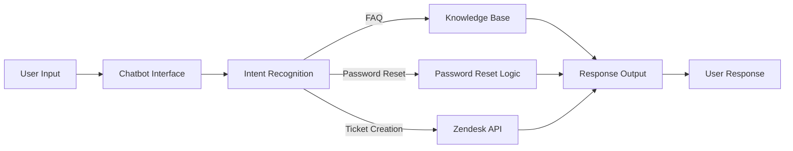

###Input:
Customer-facing IT support chatbot for FAQs, password-reset guidance, and ticket creation, used by external customers, about 500 daily chats, integrates with Zendesk and Slack, internal knowledge base only.

### Section 0 — Assumptions

- **DEPLOYMENT_TARGET** — *Assumed Cloud* — if wrong, it may affect scalability and integration 
options.
- **DATA_SENSITIVITY** — *Assumed Internal* — if wrong, it may require additional compliance 
measures.
- **SCALE** — *Assumed Team* — if wrong, it may necessitate a more robust architecture.
- **APPROVED_STACK** — *Assumed standard tech stack* — if not specified, may limit technology 
choices.

---

### 1. Problem Statement

The system will handle customer inquiries via a chatbot, providing responses to FAQs, guidance 
on password resets, and facilitating ticket creation. It will integrate with Zendesk for ticket 
management and Slack for internal communication. Success means achieving a response accuracy of 
over 90% for FAQs and a seamless ticket creation process.

**Success criterion:** Achieve a 90% accuracy rate in responses and process 500 daily chats 
without significant delays.

---

### 2. Architecture Diagram

1. User inputs a query.
2. The chatbot interface captures the input.
3. Intent recognition determines the type of query.
4. For FAQs, it queries the internal knowledge base.
5. For password resets, it executes the password reset logic.
6. For ticket creation, it interacts with the Zendesk API.
7. Responses are compiled and sent back to the user.

---

### 3. LLM Recommendation

| Field                | Value                                        |
| -------------------- | -------------------------------------------- |
| Primary              | GPT-3.5-turbo                               |
| Why                  | Handles conversational context well and is cost-effective for the 
expected volume. |
| Confidence           | High                                        |
| Rejected alternative | GPT-4 — higher cost without significant benefit for the use case. |
| Fallback             | Default to scripted responses for FAQs.     |

Assumed context window: 4,096 tokens. The workload is latency-bound due to real-time user 
interaction.

---

### 4. Embedding Recommendation

Not required — the system focuses on structured FAQs and ticket creation rather than 
unstructured retrieval tasks.

---

### 5. Vector Database

Not required — the internal knowledge base is likely under 100k entries, and direct access to it
will suffice without additional overhead.

---

### 6. Framework

**None — direct SDK calls.** This approach simplifies integration with Zendesk and Slack, 
reducing operational complexity and avoiding lock-in costs associated with orchestration 
frameworks.

---

### 7. APIs

| Interface          | Method + path                | Purpose                        | Auth     
| Sync/Async |
| ------------------ | ---------------------------- | ------------------------------ | ---------
| ---------- |
| Chatbot API        | POST /chat                   | Handle user queries            | OAuth2   
| Async      |
| Zendesk API        | POST /tickets                | Create support tickets         | OAuth2   
| Sync       |
| Slack API          | POST /messages               | Send notifications to Slack    | OAuth2   
| Async      |

The synchronous call to the Zendesk API is critical for immediate ticket creation.

---

### 8. Memory Strategy

| Layer                  | Decision                                       |
| ---------------------- | ---------------------------------------------- |
| Within-request context | Use the last 3 user messages for context; evict oldest when exceeding
limit. |
| Cross-turn / session   | Store user session data for 30 minutes; summarize if inactive. |
| Long-term / user       | Persist user preferences; delete after 1 year of inactivity. |
| Caching                | None — responses are generated in real-time. |

No sensitive data is retained beyond session duration.

---

### 9. Deployment

Target environment: Cloud-based deployment on AWS. Packaging will use Docker containers for easy
scaling. The rollout strategy will involve feature flags for gradual updates. The most likely 
breakage point is the integration with Zendesk, detected through error logging.

---

### 10. Evaluation

| Layer   | What              | Metric                 | Cadence     |
| ------- | ----------------- | ---------------------- | ----------- |
| Offline | golden dataset    | FAQ accuracy rate      | pre-release |
| Online  | production sample | user satisfaction score | continuous  |
| Human   | review loop       | feedback collection rate | monthly     |

The specific metric for this use case is the FAQ accuracy rate. The minimum viable golden-set 
size is 500 queries, produced by the support team.

---

### 11. Cost Estimate

1. **Unit assumptions**:
   - Token volume per request: 100 tokens
   - Requests per period: 500 daily
   - Assumed $/1M input tokens: $0.002
   - Assumed $/1M output tokens: $0.002
   - Infrastructure: $100/month (assumed — verify current pricing)

2. **Calculation**:
   - Daily input tokens: 500 requests * 100 tokens = 50,000 tokens
   - Daily output tokens: 500 requests * 100 tokens = 50,000 tokens
   - Monthly input cost: (50,000 tokens/day * 30 days) / 1,000,000 * $0.002 = $3
   - Monthly output cost: (50,000 tokens/day * 30 days) / 1,000,000 * $0.002 = $3
   - Total monthly cost: $3 + $3 + $100 = $106

3. **Range**: Low: $100, Expected: $106, High: $120 (considering potential increases in usage).

4. **Dominant cost driver**: Infrastructure costs — optimizing cloud resource usage will yield 
the most significant savings.

---

### 12. Risks

| Risk                        | Likelihood | Impact | Mitigation                                
| Detection signal                  |
| --------------------------- | ---------- | ------ | ----------------------------------------- 
| --------------------------------- |
| Integration failure with Zendesk | Medium     | High   | Conduct thorough testing pre-launch  
| Error logs and user feedback      |
| User adoption resistance     | Medium     | Medium | Provide training and clear documentation 
| User engagement metrics           |
| Inaccurate responses         | Low        | High   | Regular updates to knowledge base        
| User satisfaction scores          |
| Data retention compliance     | Low        | High   | Implement strict data retention policies
| Compliance audits                 |

---

### 13. Future Improvements

- **Increased user volume → scale architecture → support 1,000 daily chats.**
- **User feedback trends → enhance knowledge base → improve response accuracy.**
- **Integration with additional platforms → broaden support channels → increase user 
accessibility.**

Over-engineering today would be implementing a full-fledged analytics dashboard, which is 
unnecessary at the current scale.

---

### Section 14 — Open Questions

1. **What is the exact approved tech stack?** — This affects integration choices and potential 
limitations.
2. **Is there a specific compliance framework to follow?** — This will dictate data handling and
retention policies.
3. **What is the expected growth in user volume?** — This will influence scalability 
considerations.
4. **What metrics are prioritized for user satisfaction?** — This will guide evaluation and 
improvement efforts.
5. **What is the expected budget for infrastructure?** — This will impact the choice of cloud 
services and scaling strategies.