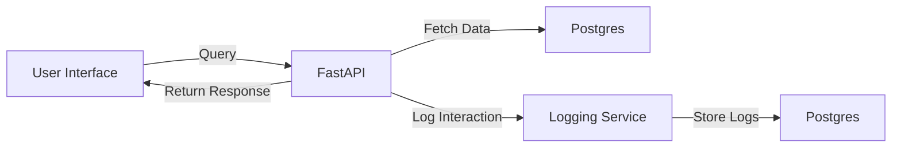

### Fail Case
uv run architect generate \
  -d "Internal support copilot for policy lookup, FAQ answers, and ticket triage" \
  --deployment-target Cloud \
  --data-sensitivity Internal \
  --scale Team
Generating architecture...
Generated markdown is missing required sections: 0, 1, 2, 3, 4, 5, 6, 7, 8, 9,
10, 11, 12, 13, 14

### Pass Case
uv run architect generate \
  -d "Internal support copilot for policy lookup, FAQ answers, and ticket triage" \
  --deployment-target Cloud \
  --data-sensitivity Internal \
  --scale Team \
  --approved-stack FastAPI \
  --approved-stack Postgres

### Section 0 — Assumptions

- **assumption** — *The system will only serve internal users, impacting security
and access controls.*
- **assumption** — *The copilot will not require real-time updates from external 
APIs, limiting complexity and dependencies.*
- **assumption** — *The volume of requests will be manageable within a team 
scale, affecting resource allocation.*
- **assumption** — *The data stored in Postgres will be structured, impacting the
design of the database schema.*

---

### 1. Problem Statement

The system will serve as an internal support copilot, enabling users to look up 
policies, retrieve FAQ answers, and triage support tickets. It will process user 
queries and return relevant information or direct them to appropriate resources. 
**Success criterion:** 90% of user queries resolved without escalation to human 
agents.

---

### 2. Architecture Diagram

1. User submits a query via the User Interface.
2. FastAPI receives the query.
3. FastAPI fetches relevant data from Postgres.
4. FastAPI returns the response to the User Interface.
5. FastAPI logs the interaction for analytics.
6. Logs are stored in Postgres for future reference.

---

### 3. LLM Recommendation

| Field                | Value                                        |
| -------------------- | -------------------------------------------- |
| Primary              | self-hosted model (e.g., GPT-3.5)          |
| Why                  | Handles policy lookup and FAQ efficiently    |
| Confidence           | High                                        |
| Rejected alternative | hosted API (cost and data sensitivity)      |
| Fallback             | fallback to static FAQs or manual escalation |

Assumed context window: 2048 tokens. Workload is latency-bound due to user 
interaction.

---

### 4. Embedding Recommendation

Not required — the system primarily relies on structured queries to Postgres 
rather than unstructured retrieval.

---

### 5. Vector Database

Not applicable — the expected corpus size is small (under 100k entries) and can 
be managed directly within Postgres without additional operational burden.

---

### 6. Framework

**None — direct SDK calls.** This choice reduces complexity and avoids vendor 
lock-in, allowing for straightforward integration with FastAPI. Debugging is 
simplified as there are fewer layers to manage.

---

### 7. APIs

| Interface         | Method + path          | Purpose                     | Auth
| Sync/Async |
| ------------------| ---------------------- | --------------------------- | 
----------- | ---------- |
| User Query        | POST /query            | Handle user queries         | 
Internal    | Sync       |
| Log Interaction   | POST /log              | Log user interactions       | 
Internal    | Async      |

---

### 8. Memory Strategy

| Layer                  | Decision                                       |
| ---------------------- | ---------------------------------------------- |
| Within-request context | Use the last 5 interactions for context, evict oldest 
when exceeding limit |
| Cross-turn / session   | Store user session data for 24 hours, summarise if 
inactive |
| Long-term / user       | Store user preferences, delete after 1 year of 
inactivity |
| Caching                | None — all data is fetched directly from Postgres |

Privacy consequence: User session data must be handled according to internal data
policies.

---

### 9. Deployment

Target environment: Cloud. Packaging will use Docker containers for FastAPI and 
Postgres. Scaling will be manual based on usage patterns. The most likely break 
point in production is database connection limits, detected through monitoring 
tools.

---

### 10. Evaluation

| Layer   | What              | Metric                 | Cadence     |
| ------- | ----------------- | ---------------------- | ----------- |
| Offline | golden dataset    | query resolution rate  | pre-release |
| Online  | production sample | user satisfaction score| continuous  |
| Human   | review loop       | feedback collection     | scheduled   |

Minimum viable golden-set size: 100 queries, produced by support staff.

---

### 11. Cost Estimate

1. **Unit assumptions**:
   - Token volume per request: 100 tokens
   - Requests per period: 1,000 requests/month
   - Assumed $/1M input tokens: $0.0004 [assumed — verify current pricing]
   - Infrastructure: $50/month for Postgres [assumed — verify current pricing]

2. **Calculation**:
   - Monthly token cost: (100 tokens/request * 1,000 requests/month) / 1,000,000 
* $0.0004 = $0.04
   - Total monthly cost: $0.04 (tokens) + $50 (Postgres) = $50.04

3. **Range**: Low: $50, Expected: $50, High: $60 (considering potential increase 
in requests).

4. **Dominant cost driver**: Database costs, as optimizing queries can 
significantly reduce operational expenses.

---

### 12. Risks

| Risk                     | Likelihood | Impact | Mitigation                    
| Detection signal                |
| ------------------------ | ---------- | ------ | 
-------------------------------- | ------------------------------- |
| Database connection limit | Medium     | High   | Monitor connections, scale up
| Connection errors in logs       |
| User adoption resistance  | Medium     | Medium | Training sessions for users  
| Feedback from user surveys      |
| Data privacy breach      | Low        | High   | Implement strict access 
controls  | Audit logs and access patterns  |
| Model performance issues  | Medium     | High   | Regular evaluation and tuning
| User satisfaction scores drop   |

---

### 13. Future Improvements

- **Increased user load → scale database → improve performance and reliability.**
- **User feedback indicates gaps → enhance FAQ database → reduce support ticket 
volume.**
- **Integration with external APIs becomes feasible → add real-time data fetching
→ enrich user experience.**

Over-engineering today: Implementing complex caching mechanisms, which may be 
necessary at larger scales.

---

### Section 14 — Open Questions

1. What is the expected volume of queries per month? — This affects resource 
allocation and scaling strategy.
2. Are there specific compliance requirements for data handling? — This could 
impact data storage and access strategies.
3. What is the expected user base size? — This influences the design of the user 
interface and performance metrics.
4. Is there a need for multi-language support? — This would require additional 
resources for model training and data handling.
5. What are the specific metrics for user satisfaction? — This will guide the 
evaluation strategy and success criteria.